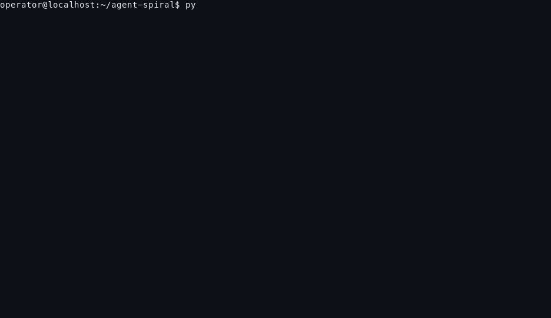

# agent-spiral


Terminal simulations of an AI agent that never comes back.

<p>
  
</p>

A question is asked. The agent starts reasoning, and the reasoning becomes a
loop. These programs follow that failure from the HTTP request all the way
down to the Planck scale, level by level, with real hardware and physics
math. Every run ends with a report that maps where a control could have
stopped the loop at each layer, and which of those controls were actually
armed (none).

Built for security engineers, SREs, and anyone who has ever watched an agent
spin.

## The simulations

| File                  | Depth       | What it shows                                                        |
|-----------------------|-------------|----------------------------------------------------------------------|
| `stuck_agent.py`      | behavior    | the reasoning loop: coherent, then circular; post-mortem plus trace  |
| `agent_stack_spiral.py` | system    | wire, tokenizer, GPU, decode loop, wire back; KV, FLOP, energy math  |
| `deeper_than_this.py` | hardware    | CUDA, tensor cores, fp16, DRAM cells, transistors, electrons         |
| `deepest.py`          | physics     | nucleus, quarks, Standard Model, fields, measurement, Planck wall    |
| `the_spiral.py`       | everything  | the complete descent L0 to L22 in one run, plus the security report  |

## Quickstart

```bash
python3 the_spiral.py              # full descent; Ctrl+C any time for the report
python3 the_spiral.py --fast       # 4x speed
python3 the_spiral.py --from L15   # start at a level
python3 stuck_agent.py -q "your question"
```

`--seconds N` is not a whole-program deadline: it bounds only the two live
loops (L4 decode, L12 clock). The remaining levels still run to completion.

No dependencies. Standard library only. Python 3.8+.

## Demo

`docs/demo.gif` is a real recording of `the_spiral.py --fast --live 1 --seconds 1`
(46 seconds, real colors). To re-record it, see `tools/render_demo.py`.

## Tests

Stdlib-only suite (no dependencies beyond Python itself):

```bash
python3 -m unittest discover -s tests
```

51 tests across three files cover compile sanity, bounded runs of all five
scripts, trace JSON validity, argument validation exit codes, broken-pipe
and closed-stdout behavior, Ctrl+C reporting, independent recomputation of
the hardware model constants, and terminal-renderer escape sequences. The
renderer tests require Pillow and are skipped when it is not installed;
CI installs it, so every test executes in the matrix. Runtime is about a
minute. CI runs the suite on Linux and macOS for every push and pull
request.

## What a run produces

Each run prints the descent and writes a trace file: a plain log followed by
a JSON summary (counters, guard map, findings). To review a failure with
another tool or agent, hand it the trace and ask it to find the issues in
the process. `traces/sample-trace.log` is an example of the format.

## What the final report includes

- The complete ladder L0 to L22 with physical scales (10^2 m to 10^-35 m).
- The guard map: per layer, the failure mode, the guard that breaks it, and
  whether it was armed.
- The finding: zero automated guards fired. In every field session the only
  control that stopped the spiral was the human pressing Ctrl+C.

## Why security engineers

Agent loops are a failure mode most stacks have no instrumentation for. The
simulation shows that every layer below the API is healthy while the spiral
runs: the GPU is at 97 percent utilization, the billing meter works, the
connection stays alive. The gap is not a broken component. The gap is a
missing termination condition, and it only exists at the layers that carry
meaning (client config through scheduler). That is where the guards go.

## Accuracy

Hardware numbers use a simplified but real model: H100-class GPU, 8B fp16
weights, GQA attention. The KV cache, FLOP, latency, and energy figures
follow from that model. Physics content (nuclear scale, confinement,
Standard Model, Planck scale) is standard material. The live demos are
visualizations, not measurements.

Experimentally verified physics in the descent ends around 10^-18 m
(particle scales). Everything from the Planck wall down is theoretical —
real math, but not measured nature — and the simulations label it as such.

## Repository layout

```
stuck_agent.py            behavior-layer simulation
agent_stack_spiral.py     full application stack simulation
deeper_than_this.py       below the GPU: hardware layers
deepest.py                below the atom: physics layers
the_spiral.py             unified complete descent L0-L22
tests/                    stdlib unittest suite (see "Tests" above)
docs/demo.gif             recorded demo of the_spiral.py
tools/                    demo recording and GIF rendering
traces/sample-trace.log   example trace output
```

## License

MIT. See LICENSE.
